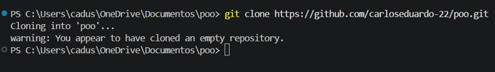
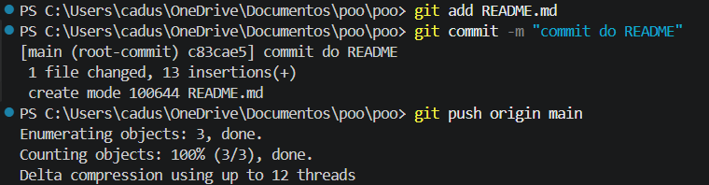
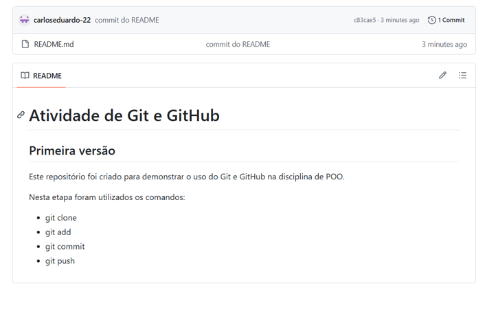
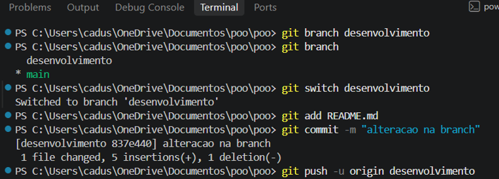
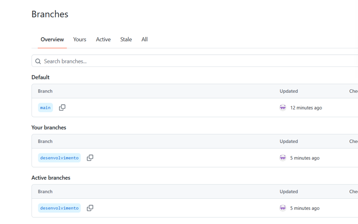
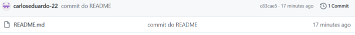

# Atividade Prática – Controle de Versões com Git e GitHub

## 1. Criação do repositório

Foi criado um repositório público chamado poo no GitHub, com o objetivo de realizar a atividade prática de controle de versões.

## 2. Clonagem do repositório

Foi utilizado o comando `git clone` para criar uma cópia local do repositório no computador.

Comando utilizado:

```bash
git clone https://github.com/carloseduardo-22/poo.git
```



## 3. Edição e versionamento

Foi criado o arquivo README.md com informações sobre a atividade.

Para registrar as alterações, foram utilizados os comandos:

```bash
git add README.md
git commit -m "commit do README"
git push origin main
```





## 4. Criação e alteração de branch

Foi criada uma nova branch chamada desenvolvimento, utilizando os comandos:

```bash
git branch desenvolvimento
git switch desenvolvimento
```

Em seguida, foi realizada uma alteração no arquivo README.md.

As alterações foram registradas e enviadas ao GitHub:

```bash
git add README.md
git commit -m "alteracao na branch"
git push -u origin desenvolvimento
```



## 5. Histórico de commits e branches

Foi utilizado o comando abaixo para visualizar o histórico de alterações:

```bash
git log --oneline --all --decorate --graph
```

No GitHub, foi possível verificar a existência das branches main e desenvolvimento.




## 6. Conclusão

A atividade permitiu conhecer na prática os principais comandos do Git e a utilização do GitHub para armazenar e controlar versões de arquivos.